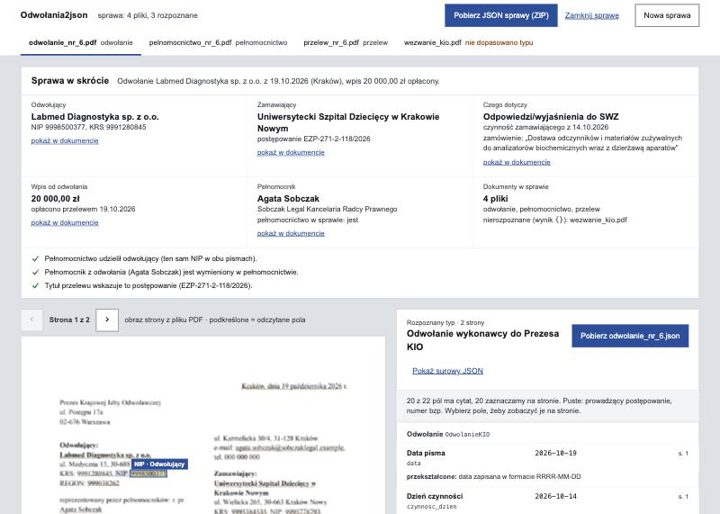
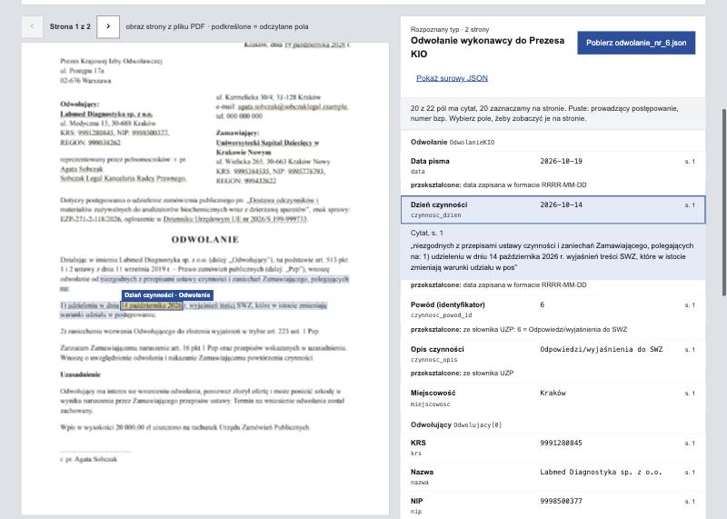

# Odwołania2json — HackNation 2026 · zadanie UZP

**Problem:** sprawa odwoławcza KIO to kilka PDF-ów (odwołanie, pełnomocnictwo, potwierdzenie przelewu) o różnym układzie; dane trzeba ręcznie przepisywać do systemów.
**Rozwiązanie:** aplikacja rozpoznaje typ każdego dokumentu i zapisuje JSON w formacie UZP, a przy każdej wartości pokazuje cytat ze źródła. Klasy dokumentów i reguły ekstrakcji są w plikach YAML, więc nową klasę dodaje się bez zmiany kodu.
**Dowód:** F1 na zbiorach przygotowanych bez wglądu w reguły: 0,997 (styl dokumentów UZP), 0,978 (pisma kancelarii); na skanach UZP nieoglądanych przy strojeniu 0,988 (OCR po API); pisma obce innych typów 14/15 poprawnie jako {}. Na zbiorze testera z nietypowymi układami 0,922. Na 60 sprawach treningowych UZP 1,000, ale to zbiór, na którym powstały reguły (`docs/WYNIKI.md`). Zero źle rozpoznanych typów i błędów formatu. 150 PDF w 4,5–5,5 min (limit UZP 45 min).
**Działający prototyp:** https://odwolania.madejski.it (limity: 10 plików, 10 MB, 20 wgrań na godzinę).

Numery rachunków w wyniku: numer rachunku tak jak w dokumencie (z PL, jeśli stoi w tekście), bez spacji (UZP, 21.11).

## Jak uruchomić

**Uruchomienie na maszynie UZP:** komenda z `deploy/vm/RUN.md` (kopiowany jako `/opt/solution/RUN.md`) uruchamia aplikację w Dockerze; wejście `/opt/solution/input` (PDF-y płasko albo w podkatalogach spraw), wynik `/opt/solution/output`, klucz w `/opt/solution/.env`. Instalacja: `deploy/vm/INSTALACJA.md` i `deploy/vm/instaluj.sh`.

Wymagania: Python 3.13+.

1. `pip install -r requirements.txt`
2. Klucz modelu: skopiuj `.env.example` do `.env` i wpisz `LLM_API_KEY` (Scaleway Generative APIs). Bez klucza aplikacja działa na samych regułach.
3. Pliki PDF do `./input/<sprawa>/`, uruchom `./run.sh` (Windows: `start.bat` albo `run.bat`), wyniki w `./output/<sprawa>/`. Bez skryptów, na każdym systemie i z dowolnego katalogu: `python run.py` (to samo co `./run.sh`; `python run.py --web` uruchamia podgląd).

**Po czym poznać, że model działał:** na końcu przebiegu linia `Podsumowanie: model …: N wywołań, 0 błędów, 0 dokumentów bez modelu` (i `OCR: … stron`). Przy awarii klucza albo sieci w logu jest `MODEL WYŁĄCZONY: …`, a reszta idzie samymi regułami. Program potrzebuje wyjścia do `https://api.scaleway.ai:443`.

Czas: pliki idą równolegle (`PLIKI_WATKI`, domyślnie 8; zapytania do API najwyżej `API_WATKI`=8 naraz), budżet przebiegu `MAKS_CZAS_S` (domyślnie 2100 s). Po jego wyczerpaniu pozostałe pliki idą samymi regułami, a pliki wynikowe i tak powstają.

Skany (strony bez warstwy tekstowej) czyta model po API (ten sam klucz), bez instalacji systemowych. Opcjonalnie Tesseract (`brew install tesseract` / `apt install tesseract-ocr` + `scripts/pobierz_ocr.sh`) jako zapas bez sieci.

```bash
pip install -r requirements.txt
cp .env.example .env   # wpisz LLM_API_KEY
python run.py       # bez skryptów (każdy system); to samo: ./run.sh, Windows: start.bat / run.bat
./run.sh            # przetwarza ./input/<sprawa>/*.pdf do ./output/<sprawa>/<ta sama nazwa>.json
./run.sh --web      # prototyp w przeglądarce: http://localhost:8000 (wgranie PDF, podgląd JSON z cytatami)
```

Albo w Dockerze (Tesseract z językiem polskim jest w obrazie, bez GPU):

```bash
docker compose run --rm odwolania2json   # ./input -> ./output
docker compose up web                    # http://localhost:8000 (inny port: WEB_PORT=8080 docker compose up web)
```

Stały podgląd na serwerze (proces w tmux, przetrwa zamknięcie terminala; po restarcie maszyny jedna komenda):

```bash
tmux new-window -d -t hackn -n app-dev06 -c "$PWD" './run.sh --web --host 127.0.0.1 --port 8006'
```

Strona publiczna ma limity: 10 plików i 10 MB na wgranie, 20 wgrań na godzinę z jednego adresu (`WEB_MAKS_PLIKOW`, `WEB_MAKS_MB`, `WEB_WGRAN_NA_GODZINE`).

- Dokument spoza znanych klas: komunikat „nie dopasowano typu” i plik `.json` o tej samej nazwie z zawartością `{}` (przełącznik `obcy` w `config/aplikacja.yaml`: `pusty_obiekt` | `pusty_plik` | `brak_pliku`).
- Cytaty, strona i użyta reguła dla każdego pola: `./audit/<sprawa>/<nazwa>.json`.
- Pomiar jakości na danych UZP: `scripts/pobierz_dane.sh`, potem `PYTHONPATH=src python -m odwolania2json.eval --pred output`.

## Jak to działa

1. Tekst z PDF (warstwa tekstowa; stopki stron usuwane). Strony bez tekstu (skany) idą przez OCR po API: model z wejściem obrazowym u tego samego dostawcy (domyślnie Mistral Small 3.2 24B, Apache-2.0 — najwyższe F1 w porównaniu na skanach UZP; gdy nie zwróci tekstu, Gemma; `ocr_model` / `OCR_MODEL` w `config/model.yaml`), ok. 10–15 s na stronę, strony równolegle; zapasowo Tesseract, jeśli jest w systemie (jest w obrazie Dockera). Numery stron z OCR trafiają do audytu.
2. Klasyfikacja: sygnały z `config/klasy/*.yaml` (tytuł, słowa kluczowe, sygnały ujemne innych pism); przy niskiej pewności rozstrzyga model, bez sygnałów = dokument obcy.
3. Ekstrakcja: dla każdego pola zapisywany jest najlepszy kandydat z reguł (zła wartość kosztuje w F1 tyle co brak, więc pole zostaje puste tylko, gdy w dokumencie go nie ma); silnik wykonuje opis klasy z YAML (sekcje, etykiety, wyrażenia regularne, słownik powodów odwołania, listy, normalizatory dat, kwot, rachunków, BZP, TED).
4. Wynik: JSON w formacie `oczekiwane-json` UZP + plik audytu z cytatami.

## Podgląd w przeglądarce

`python run.py --web` (http://localhost:8000): wgrywasz wszystkie PDF-y sprawy naraz. Na górze karta „Sprawa w skrócie” (odwołujący, zamawiający, czego dotyczy, wpis i czy opłacony, pełnomocnik, dokumenty, w tym nierozpoznane) ze sprawdzeniem zgodności pism (NIP mocodawcy, pełnomocnik, tytuł przelewu). Niżej strona PDF obok listy pól: kliknięcie pola przechodzi do jego strony i zaznacza cytat i wartość. Strony ze skanu nie mają położenia tekstu, więc pokazujemy stronę i cytat. Skany mają postęp per plik. Pobieranie: JSON pliku albo ZIP całej sprawy (te same pliki co w `./output`). Bez sieci: żadnych bibliotek ani fontów z zewnątrz.




Skan (OCR): `docs/zrzuty/03-skan-ocr.png`, dokument obcy z wynikiem `{}`: `docs/zrzuty/04-dokument-obcy.png`, postęp przetwarzania: `docs/zrzuty/05-przetwarzanie-skanu.png`.

## API do integracji

1. `POST /api/sprawa` (formularz, pole `pliki`, kilka PDF-ów) zwraca `id` sprawy; `?czekaj=true` czeka na pełny wynik.
2. `GET /api/sprawa/{id}`: stan każdego pliku (`oczekuje`, `przetwarzanie`, `gotowe`, `blad`), `klasa` (null = dokument obcy), `json` (format UZP), `audyt` (cytat, strona, metoda) i `polozenia` (prostokąty cytatu na stronie, ułamki 0–1).
3. `GET /api/sprawa/{id}/zip` albo `/plik/{nr}.json`: pliki jak w `./output`; `/plik/{nr}/strona/{s}.png`: obraz strony.
4. `DELETE /api/sprawa/{id}` usuwa pliki od razu (inaczej po `WEB_SPRAWA_MIN`, domyślnie 60 min).
5. Pełny opis z przykładami: `/docs` (OpenAPI: `/openapi.json`). Przykład: `curl -F pliki=@odwolanie.pdf -F pliki=@przelew.pdf "http://localhost:8000/api/sprawa?czekaj=true"`.

## Model językowy

**Użyty model: Gemma 4 26B-A4B Instruct** (`gemma-4-26b-a4b-it`, Google, licencja Apache-2.0, otwarte wagi, 26 mld parametrów w architekturze MoE) przez **Scaleway Generative APIs** (Francja, region Paryż, API zgodne z OpenAI). Wybrany jako model z najwyższym albo prawie najwyższym F1 na wszystkich zbiorach; porównanie z mniejszymi modelami w `docs/WYNIKI.md`.

**Dlaczego Gemma i co dają mniejsze modele.** Większość pracy robią reguły z plików YAML. Gdy model ekstrakcji nie działa (np. zły klucz), program dalej oddaje wynik: na zbiorze niezależny A, styl UZP, F1 0,991 zamiast 0,997; na pismach kancelarii 0,900 zamiast 0,978; na nietypowych układach 0,695 zamiast 0,922; na skanach UZP nieoglądanych 0,964 zamiast 0,988. Sprawdziliśmy też małe modele otwartych wag (pomiar porównawczy u dostawcy testowego, 21/22.11, na wcześniejszej wersji kodu b1e0630, OCR w każdym wariancie ten sam: Mistral Small 3.2 24B; na wersji zgłoszenia Gemma ma na tym zbiorze 0,979). Na zbiorze niezależny B, 100 PDF, styl UZP: same reguły 0,960, Gemma 4 26B-A4B 0,970, Qwen 3.5 9B 0,966, Ministral 3 3B 0,963. Nawet model 3 mld parametrów trzyma od 0,88 do 0,99 (na nietypowych układach 0,88, tyle co Gemma), a Qwen 3.5 9B jest średnio ok. 0,005 F1 za Gemmą; małe modele tracą głównie na pełnomocnictwach (nazwa i typ mocodawcy, osoby). Gemma dała najwyższe albo prawie najwyższe F1 w każdym zbiorze, dlatego jest w zgłoszeniu. Model zmienia się jedną linią w `.env` (`LLM_MODEL`), bez zmian w kodzie, więc mniejszy wariant można uruchomić samemu. Czas: 150 PDF w 4,5–5,5 min, przy serwerze modelu spowolnionym o 20 s na zapytanie w 19 min, przy limitach dostawcy w 21 min (limit UZP 45 min). Pełne tabele i opis zbiorów: `docs/WYNIKI.md`.

Modele po API: Gemma 4 26B-A4B (ekstrakcja, klasyfikacja przy niskiej pewności), Mistral Small 3.2 24B (OCR skanów; zapas Gemma). Oba Apache-2.0, otwarte wagi, Scaleway (UE). Wybór OCR: najwyższe F1 na skanach UZP (`docs/WYNIKI.md`).

Przetwarzanie danych: serwery w UE (Paryż, Francja); zakres i miejsce przetwarzania opisują [zasady prywatności danych Scaleway Generative APIs](https://www.scaleway.com/en/docs/generative-apis/reference-content/data-privacy/) (domyślnie bez przechowywania treści zapytań, bez trenowania modeli na danych klienta) oraz [Polityka Prywatności Scaleway](https://www.scaleway.com/en/privacy-policy/).

Reguły z YAML wypełniają pola same. Model:
- uzupełnia pola, których reguły nie wyciągnęły albo których walidator nie przyjął (np. nazwa zamawiającego, tytuł zamówienia, numer postępowania, pełnomocnik);
- wskazuje blok strony (odwołującego, zamawiającego), gdy dokument nie ma etykiet — dalej działają zwykłe reguły;
- rozstrzyga typ dokumentu przy niskiej pewności reguł.

Odpowiedź modelu musi występować w tekście dokumentu, inaczej jest odrzucana; przy przyjętej wartości audyt zapisuje cytat i metodę `llm`.

- Konfiguracja: `config/model.yaml` (`tryb: api | lokalny | brak`, zmienna `MODEL_TRYB`), klucz tylko w `.env` (`LLM_API_KEY`; wzór w `.env.example`).
- Bez klucza albo przy błędzie API (3 błędy) aplikacja kończy na samych regułach, bez przerwy w pracy.

## Nowe klasy dokumentów

Jeden plik YAML na klasę. Instrukcja i lista klocków: `docs/NOWA-KLASA.md`. Budowa aplikacji (moduły, przepływ jednego pliku, konfiguracja klasy krok po kroku na przykładzie przelewu): [`docs/ARCHITEKTURA.md`](docs/ARCHITEKTURA.md). Przykład czwartej klasy (zgłoszenie przystąpienia): `config/klasy-demo/przystapienie.yaml`. Klasa opisowa bez wyrażeń regularnych (odpowiedź na odwołanie, 15 linii samych opisów pól): `config/klasy-demo/odpowiedz_na_odwolanie.yaml`. Klasy demo są domyślnie wyłączone; włącza je `--klasy-dodatkowe config/klasy-demo`.

## Źródła i cytowania

`ZRODLA-I-CYTOWANIA.md`.

## Licencja

Kod aplikacji: Apache License 2.0 (plik `LICENSE`). Wszystkie zależności i modele są otwarte (`ZRODLA-I-CYTOWANIA.md`).
