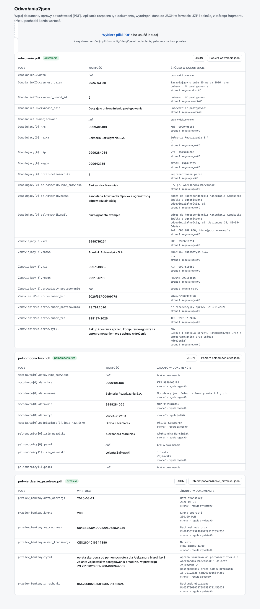

# Odwołania2json — HackNation 2026 · zadanie UZP

**Problem:** sprawa odwoławcza KIO to kilka PDF-ów (odwołanie, pełnomocnictwo, potwierdzenie przelewu) o różnym układzie; dane trzeba ręcznie przepisywać do systemów.
**Rozwiązanie:** aplikacja rozpoznaje typ każdego dokumentu i zapisuje JSON w formacie UZP, a przy każdej wartości pokazuje cytat ze źródła. Klasy dokumentów i reguły ekstrakcji są w plikach YAML, więc nową klasę dodaje się bez zmiany kodu.
**Dowód:** F1 = 1,00 na 60 sprawach treningowych UZP (2032 pola, porównanie pole po polu, `docs/WYNIKI.md`).

## Jak uruchomić

Wymagania: Python 3.13+.

```bash
pip install -r requirements.txt
./run.sh            # Windows: run.bat  — przetwarza ./input/<sprawa>/*.pdf do ./output/<sprawa>/<ta sama nazwa>.json
./run.sh --web      # prototyp w przeglądarce: http://localhost:8000 (wgranie PDF, podgląd JSON z cytatami)
```

- Dokument spoza znanych klas daje pusty plik `.json`.
- Cytaty, strona i użyta reguła dla każdego pola: `./audit/<sprawa>/<nazwa>.json`.
- Pomiar jakości na danych UZP: `scripts/pobierz_dane.sh`, potem `PYTHONPATH=src python -m odwolania2json.eval --pred output`.

## Jak to działa

1. Tekst z PDF (warstwa tekstowa; stopki stron usuwane).
2. Klasyfikacja: suma wag słów kluczowych z `config/klasy/*.yaml`; poniżej progu = dokument obcy.
3. Ekstrakcja: silnik wykonuje opis klasy z YAML (sekcje, etykiety, wyrażenia regularne, słownik powodów odwołania, listy, normalizatory dat, kwot, rachunków, BZP, TED).
4. Wynik: JSON w formacie `oczekiwane-json` UZP + plik audytu z cytatami.



## Nowe klasy dokumentów

Jeden plik YAML na klasę. Instrukcja i lista klocków: `docs/NOWA-KLASA.md`. Przykład czwartej klasy (zgłoszenie przystąpienia): `config/klasy-demo/przystapienie.yaml`.

## Źródła i cytowania

`ZRODLA-I-CYTOWANIA.md`.
