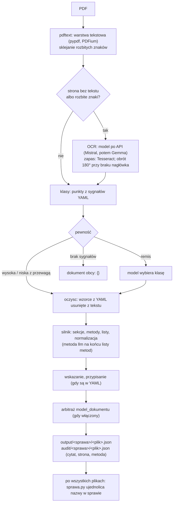

# Architektura

Aplikacja zamienia PDF-y sprawy odwoławczej KIO na pliki JSON w formacie UZP. Kod jest ogólny: nie zna nazw klas dokumentów ani pól. Co rozpoznać i co wyciągnąć, mówią pliki `config/klasy/*.yaml` (jeden plik = jedna klasa). Model językowy po API jest dodatkiem: czyta skany, rozstrzyga typ przy niskiej pewności i uzupełnia pola, których reguły nie znalazły. Bez modelu aplikacja działa na samych regułach.

Kod jest w `src/odwolania2json/`, konfiguracja w `config/`.

## Moduły

### Wejście: tekst z PDF

**`pdftext.py`** czyta tekst każdej strony.

- Warstwa tekstowa przez pypdf. Strony o słabym tekście (ocena `jakosc()` poniżej 0,75, np. czcionki bez mapy znaków) czyta też PDFium i bierze lepszy wynik.
- Rozbite polskie znaki: litera i osobny znak diakrytyczny („a˛”, „z˙”) są sklejane w jedną literę (`napraw_znaki`). Strona z co najmniej trzema takimi znakami idzie też do OCR, bo „ł” rysowane kreską w ogóle nie ma znaku w tekście.
- Strona z mniej niż 50 znakami to skan i idzie do OCR. OCR ma kolejkę silników (`ocr: [model, tesseract]` w `config/aplikacja.yaml`, zmienna `OCR_SILNIKI`): pierwszy, który zwróci tekst, wygrywa.
  - `model`: obraz strony (150 dpi, `OCR_DPI_MODEL`) do modelu z wejściem obrazowym po API. Modeli może być kilka (`ocr_model` w `config/model.yaml`, zmienna `OCR_MODEL`, po przecinku): domyślnie Mistral Small 3.2, a gdy nie zwróci tekstu, Gemma 4. Odpowiedź typu „obraz jest pusty” nie jest tekstem strony. Ta sama strona idzie do modelu raz w przebiegu (pamięć po skrócie obrazu).
  - `tesseract`: program systemowy, jeśli jest (jest w obrazie Dockera); `OCR_DPI`, `OCR_LANG`.
- Obrót skanu: gdy strona 1 po OCR nie ma nagłówka (tytuł pisma albo data na początku), jedna próba po obrocie o 180°. Jeśli wtedy nagłówek jest, cały dokument jest czytany obrócony. `OCR_OBROT=0` wyłącza.
- W przebiegu wsadowym OCR obejmuje strony 1–2 (na 30 skanach UZP dalsze strony nie dały żadnego pola). W WWW wszystkie strony. `OCR_MAKS_STRON` nadpisuje (0 = wszystkie). Strony jednego pliku idą równolegle (`OCR_WATKI`, domyślnie 4). `OCR=0` wyłącza OCR.

### Rozpoznanie typu

**`klasy.py`** wczytuje klasy z `config/klasy/` (i z katalogów dodatkowych, gdy są włączone) i liczy punkty z sygnałów w sekcji `rozpoznanie` każdej klasy: wzorce tytułu, słowa w treści, sygnały ujemne (cechy innych pism), wykluczenia.

0. Dowód pozytywny: klasa, która nie ma minimalnego zestawu cech z `rozpoznanie.wymagane` (każda grupa alternatyw musi mieć trafienie), odpada przed liczeniem; model też nie może jej przywrócić. Przelew wymaga kwoty, daty, rachunku (24–28 cyfr) i etykiety operacji, więc broszura banku czy odpis KRS z rachunkiem dostają `{}`.
1. Najlepsza klasa ma co najmniej swój `prog` i przewagę nad drugą: ta klasa (pewność wysoka).
2. Poniżej progu, ale co najmniej `min_punkty` i przewaga `przewaga` (`config/aplikacja.yaml`, sekcja `klasyfikacja`): najlepsza klasa (pewność niska).
3. Są sygnały, ale nic nie rozstrzyga: pyta model (`wybierz_klase`). Gdy API nie odpowiada, wygrywa najlepsza klasa z reguł.
4. Brak sygnałów: dokument obcy, w `./output` plik z `{}`.

### Ekstrakcja

**`silnik.py`** wykonuje sekcję `wynik` z YAML klasy na tekście. Drzewo `wynik` ma ten sam kształt co JSON UZP. Klocki:

- **sekcje** (`sekcje:`): fragment tekstu od wzorca `od` do najbliższego `do` (albo `max_znakow`); sekcja może leżeć w innej (`w`), wystąpić wiele razy (`wiele`) albo dostać kotwicę od modelu (`llm`), gdy `od` nic nie znalazł;
- **metody** pola (`metody:`), próbowane po kolei, pierwsza niepusta wygrywa: `regex` (grupa `v`), `etykieta` („Etykieta: wartość” albo wartość w następnej linii), `slownik`, `jesli`, `stala`, `calosc` (cała sekcja), `llm` (pytanie do modelu);
- **listy** (`lista:`): elementy z sekcji albo z trafień wyrażenia, z `rozdziel`, `wymagaj`, `unikalne`, `max`; `warianty` to kilka sposobów znalezienia elementów dla różnych układów dokumentu (wygrywa pierwszy, który daje elementy).

Przy każdej wartości silnik zapisuje dowód: metodę, cytat i pozycję w tekście. Z tego powstaje audyt.

**`normalizacja.py`**: normalizatory wołane z YAML po nazwie (`normalizuj: [data_iso, kwota, rachunek, …]`). Każdy zwraca wartość w formacie UZP albo `None`, gdy nie umie. `None` znaczy „ta metoda nic nie dała” i silnik próbuje następnej.

**`llm.py`**: klient modelu za adresem zgodnym z OpenAI API (`config/model.yaml`: `tryb: api | lokalny | brak`, zmienna `MODEL_TRYB`; klucz tylko z `.env`, `LLM_API_KEY`).

- Ponowienia przy HTTP 429/5xx i zerwanym połączeniu: odczekanie 1, 2, 4 s, łącznie najwyżej 15 s.
- Po `max_bledow` błędach w jednym dokumencie model milknie do końca tego dokumentu.
- Wyłącznik przebiegu (wspólny dla ekstrakcji i OCR): HTTP 401/403/404 albo 3 kolejne błędy bez udanej odpowiedzi wyłączają model do końca przebiegu. Zostają reguły (i Tesseract, jeśli jest).
- Ogranicznik równoległości: najwyżej `API_WATKI` (domyślnie 8) zapytań naraz, model i OCR razem; po HTTP 429 limit spada o połowę.
- Odpowiedź z metody `llm` musi występować w tekście dokumentu, inaczej jest odrzucana.

**`arbitraz.py`**: sekcja `model_dokumentu` w YAML klasy (dziś włączona w pełnomocnictwie). Model dostaje cały dokument i zwraca JSON w formacie wyniku. Każda wartość jest sprawdzana w tekście: osoba po rdzeniach członów imienia i nazwiska, nazwa z podobieństwem co najmniej 0,85, cyfry dokładnie, wartości słownikowe z listy. Odrzucona wartość wraca do wyniku reguł. `MODEL_ARBITRAZ=0/1` nadpisuje ustawienie.

**`wskazanie.py`**: sekcja `wskazanie`. Element listy wskazany zdaniem w treści (np. który z dwóch zamawiających prowadzi postępowanie: „postępowanie przygotowuje i przeprowadza Gmina X”). Działa tylko przy co najmniej dwóch elementach i jednoznacznym trafieniu.

**`przypisanie.py`**: sekcja `przypisanie`. Elementy podlisty trafiają do właściwego elementu listy po wzmiance w tekście (np. podpisujący do właściwego mocodawcy w pełnomocnictwie konsorcjum).

**`opisowa.py`**: klasa opisowa, czyli klasa opisana samymi słowami (sekcja `pola` zamiast `wynik`), bez wyrażeń regularnych. Jedno pytanie do modelu, każda wartość sprawdzana w tekście. Opis w `docs/NOWA-KLASA.md`.

### Sprawa i przebieg

**`sprawa.py`**: po przetworzeniu wszystkich plików ujednolica nazwy w obrębie sprawy (katalog w `./output`). Gdy dwie wartości `imie_nazwisko` albo `nazwa` różnią się tylko polskimi znakami (błąd OCR: „Zaneta” i „Żaneta”), wszędzie trafia wariant z polskimi znakami. `ujednolicaj_nazwy` w `config/aplikacja.yaml`, zmienna `UJEDNOLICAJ_NAZWY`.

**`budzet.py`**: budżet czasu przebiegu wsadowego. README UZP daje 45 minut na 150 PDF-ów; `MAKS_CZAS_S` domyślnie 2100 s (35 min). Każde zapytanie do API i każdy OCR dostaje timeout przycięty do pozostałego budżetu. Po wyczerpaniu kolejne dokumenty idą samymi regułami, a pliki wynikowe i tak powstają. W WWW budżetu nie ma, jest dzienny sufit wywołań modelu (`WEB_MAKS_WYWOLAN_DZIENNIE`, domyślnie 1500), po którym strona działa na regułach.

**`potok.py`**: przetwarzanie jednego pliku (opis niżej). Wyjątek w jednym pliku nie przerywa przebiegu: druga próba samymi regułami, a gdy i ona zawiedzie, wynik pusty.

**`__main__.py`**: wiersz poleceń (`python -m odwolania2json --input ./input --output ./output`, `--audit`, `--bez-llm`, `--klasy-dodatkowe`).

- Kolejność plików: najpierw PDF-y z warstwą tekstową (szybkie), potem skany wielostronicowe, na końcu jednostronicowe. Gdy budżet się skończy, bez OCR zostają dokumenty z najmniejszą liczbą pól.
- Pliki równolegle: `PLIKI_WATKI` (domyślnie 8; 1 = po kolei). JSON każdego pliku zapisuje się od razu po nim.
- Dokument obcy: `{}` (domyślnie), plik 0 B albo brak pliku (`obcy` w `config/aplikacja.yaml`, zmienna `OBCY`).
- Na końcu ujednolicenie nazw w sprawach i linia podsumowania (wywołania modelu, błędy, strony OCR).

### Interfejs WWW i pomiar

**`web.py`** (FastAPI): strona i API (`POST /api/sprawa`, `GET /api/sprawa/{id}`, ZIP, JSON pliku, obraz strony; opis w `/docs`). Limity strony publicznej: `WEB_MAKS_PLIKOW` (10), `WEB_MAKS_MB` (10), `WEB_WGRAN_NA_GODZINE` (20 z jednego adresu), `WEB_MAKS_STRON` (20 stron OCR na plik), `WEB_WATKI` (3 pliki naraz). `HOST`, `PORT`, `KLASY_DIR`, `BEZ_LLM=1`.

**`sprawy.py`**: sprawa wgrana przez stronę żyje w pamięci i w katalogu tymczasowym najwyżej `WEB_SPRAWA_MIN` minut (domyślnie 60) albo do `DELETE /api/sprawa/{id}`. Pliki przetwarzane w tle, stan każdego pliku osobno.

**`podglad.py`**: obraz strony PDF (PNG) i położenie cytatu na stronie z warstwy tekstowej (PDFium), jako ułamki szerokości i wysokości. Strony ze skanu nie mają położenia: podgląd pokazuje stronę i cytat.

**`static/`**: strona w przeglądarce (`index.html`, `app.js`, `skrot.js` — karta „Sprawa w skrócie”, `styl.css`, `jak-to-dziala.html`). Bez bibliotek i fontów z zewnątrz.

**`eval.py`**: F1 pole po polu według metody UZP (TP, FP, FN; pola długie z `config/ewaluacja.yaml` z podobieństwem co najmniej 0,8). `python -m odwolania2json.eval --gold <referencje> --pred output`.

## Przepływ jednego pliku



Budżet czasu (`budzet.py`) pilnuje każdego kroku z API: gdy się skończy, OCR i model są pomijane, a reszta przebiegu idzie regułami.

## Konfiguracja klasy na przykładzie `config/klasy/przelew.yaml`

Plik ma 144 linie i w całości opisuje potwierdzenie przelewu. Kod nie zawiera ani jednego słowa o przelewach.

**1. Nazwa i rozpoznanie.** Sygnały z wagami: wzorce tytułu (w strefie tytułu, bez spacji, wielkimi literami), słowa z treści, sygnały ujemne. `prog` to minimum punktów dla pewnego rozpoznania.

```yaml
nazwa: przelew
rozpoznanie:
  prog: 4
  tytul:
    'DOW[ÓO]DWYKONANIA|ELIXIR|HISTORIATRANSAKCJI|SZCZEG[ÓO][ŁL]YTRANSAKCJI': 4
  slowa:
    'rachunek\s+(?:odbiorcy|zleceniodawcy|nadawcy|beneficjenta|obci[aą][żz]any|uznawany|[źz]r[oó]d[łl]owy|docelowy)': 2
  tytul_ujemne:
    'PE[ŁL]NOMOCNICTWO': 6
```

Sygnał ujemny „PEŁNOMOCNICTWO” w tytule odejmuje 6 punktów, więc pełnomocnictwo z załączonym przelewem nie zostanie przelewem.

**2. Czyszczenie.** `oczysc:` to wzorce usuwane z tekstu przed ekstrakcją, tu pieczątka wpływu wtrącona w skan:

```yaml
oczysc:
  - '(?m)^[ \t]*Podpis\s+Kierownika[^\n]*\n?'
```

**3. Sekcje.** Fragment tekstu, w którym szuka się pola. Sekcja `tytul` zaczyna się od etykiety „Tytuł” i kończy na następnej etykiecie albo po 400 znakach:

```yaml
sekcje:
  list_banku:   # potwierdzenie w formie pisma: "Bank potwierdza, że w dniu ... z rachunku nr ..."
    od: 'bank\s+potwierdza'
    max_znakow: 1500
```

**4. Pola i metody.** Drzewo `wynik` ma kształt JSON-a UZP (`przelew_bankowy.data_operacji`, `kwota`, `na_rachunek`, …). Każde pole ma listę metod, od najdokładniejszej do najogólniejszej; pierwsza, która da wartość po normalizacji, wygrywa:

```yaml
    kwota:
      metody:
        - etykieta: ['kwota(?:\s+(?:operacji|przelewu))?', 'warto[śs][ćc]']
        - regex: 'w\s+kwocie\s+(?P<v>[\d\s.,]+)'
      normalizuj: [kwota]
      typ: float
```

- `etykieta`: wartość po etykiecie w tej samej linii albo w następnej;
- `regex`: wartość z grupy `(?P<v>…)`; `ktory: 2` bierze drugie trafienie (np. drugi numer rachunku), `w: list_banku` szuka tylko w sekcji;
- `calosc`: cała treść sekcji, np. tytuł przelewu z sekcji `tytul` albo `opis`:

```yaml
        - calosc: true
          w: [tytul, opis]
```

- `llm`: pytanie do modelu, zwykle ostatnia metoda pola. Przelew jej nie potrzebuje; przykład z `config/klasy/odwolanie.yaml`:

```yaml
        - llm: 'Jaki jest tytuł (nazwa) zamówienia publicznego, którego dotyczy odwołanie? Podaj sam tytuł bez cudzysłowów.'
```

**5. Normalizacja.** `normalizuj:` przy polu albo przy jednej metodzie: `data_iso` (data na RRRR-MM-DD, także słownie), `kwota` (liczba), `rachunek` (numer rachunku tak jak w dokumencie: z PL, jeśli stoi w tekście, bez spacji), `rachunek_drugi` (drugi z dwóch numerów w komórce), `rachunek_znany` (numer z OCR ze zgubionymi albo przekręconymi cyframi zamieniony na bliski numer z `config/znane_rachunki.yaml`, różnica najwyżej `max_roznica`), `jedna_linia`, `bez_cudzyslowow`, `bez_kropki`. `typ: float` zamienia wynik na liczbę.

**6. Walidacja.** Osobnej sekcji walidacji w YAML nie ma; sprawdzanie jest wbudowane w klocki:

- normalizator, który nie umie sprowadzić wartości do formatu UZP (np. rachunek bez 26 cyfr), zwraca `None` i silnik bierze następną metodę;
- odpowiedź z metody `llm` musi występować w tekście dokumentu (`sprawdz: w_tekscie`, domyślnie), inaczej jest odrzucana;
- wartości z arbitrażu (`model_dokumentu`) przechodzą sprawdzenie w tekście opisane przy `arbitraz.py`.

**7. Model (`llm:`).** Model pojawia się w YAML w trzech miejscach: metoda `llm` pola (pytanie o jedną wartość), `llm` przy sekcji (model wskazuje początek bloku, gdy reguła `od` nic nie znalazła, np. blok odwołującego bez etykiety) i `model_dokumentu` (arbitraż całego dokumentu). Który model, mówi `config/model.yaml`; YAML klasy nie zależy od dostawcy.

Pełna lista klocków i instrukcja dodania nowej klasy: [`docs/NOWA-KLASA.md`](NOWA-KLASA.md).
